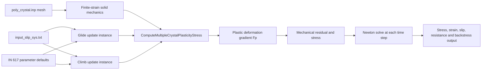
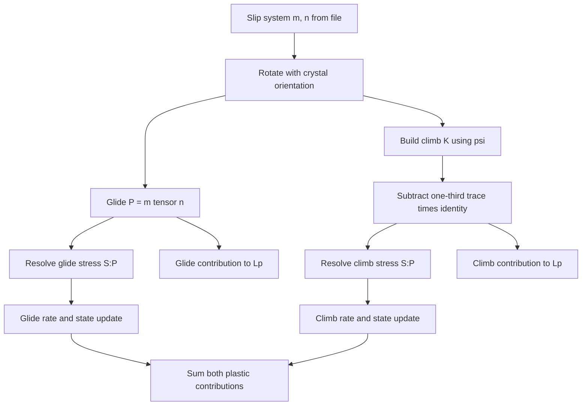

# Dislocation Glide and Climb CPFE: MOOSE Implementation

## Scope and Model

This document describes the implementation of thermally activated dislocation glide and climb in the `godzilla` MOOSE application. The constitutive model is implemented as one MOOSE crystal-plasticity stress-update object, `CrystalPlasticityDislocationCreepUpdate`, instantiated twice: once for glide and once for climb. Both instances are combined by `ComputeMultipleCrystalPlasticityStress` and contribute to the same finite-strain plastic deformation update.

The equations and IN 617 calibration values are based on Zhang and Oskay's cyclic-loading model [P1] and the climb extension of Phan et al. [P2]. The defaults represent **IN 617 at 950 °C**, not calibrated 316L. This implementation is a starting point for the 316L cladding model; it does not yet evolve dislocation density, model irradiation point defects, or solve a vacancy transport equation. The equation derivation, source mapping, and literature discussion are in [dislocation_glide_climb_based_cpfe.md](dislocation_glide_climb_based_cpfe.md).

In one material point and one time increment, the two constitutive instances provide

$$
\mathbf L^p = \sum_{\alpha=1}^{N}\dot\gamma_g^\alpha\mathbf P_g^\alpha+
             \sum_{\alpha=1}^{N}\dot\gamma_c^\alpha\mathbf P_c^\alpha,
\qquad
\tau_g^\alpha=\mathbf S:\mathbf P_g^\alpha,
\qquad
\tau_c^\alpha=\mathbf S:\mathbf P_c^\alpha.
$$

Here $\mathbf P_g^\alpha$ is the rotated glide Schmid tensor and $\mathbf P_c^\alpha$ is the deviatoric climb tensor used by this code. MOOSE's stress-update base uses each instance's rate and flow tensor to update the plastic deformation gradient and form the constitutive tangent contribution from the rate derivative, with state variables held fixed during that derivative. The state updates are handled by the staggered local iteration described below.

## Application Architecture

The application code follows the MOOSE crystal-plasticity extension points. No MOOSE framework source is modified.

The implementation files are:

| File | Responsibility |
|---|---|
| [`include/materials/CrystalPlasticityDislocationCreepUpdate.h`](../include/materials/CrystalPlasticityDislocationCreepUpdate.h) | Declares the material class, MOOSE overrides, parameters, and state vectors. |
| [`src/materials/CrystalPlasticityDislocationCreepUpdate.C`](../src/materials/CrystalPlasticityDislocationCreepUpdate.C) | Registers the material and implements initialization, flow rules, derivatives, state updates, and convergence checks. |
| [`in617_f5_cycle.i`](../in617_f5_cycle.i) | Full F-5 cyclic loading example using the Abaqus mesh and both mechanisms. |
| [`references/numerical_checks/check_in617_creep.py`](numerical_checks/check_in617_creep.py) | Standalone Python sanity checks for selected equations and derivatives. |

`CrystalPlasticityDislocationCreepUpdate` derives from MOOSE's `CrystalPlasticityStressUpdateBase`. MOOSE calls the virtual methods within its per-quadrature-point constitutive solve. `mechanism = glide` selects the glide law; `mechanism = climb` selects climb. The glide instance uses the default material-property prefix. The climb instance uses `base_name = climb`, which keeps its rate, flow direction, applied shear stress, and backstress properties separate from those of glide.

## Kinematics and Shared MOOSE Update

The application retains MOOSE's finite-strain kinematics and stress measure. MOOSE updates $\mathbf F^p$ from the sum of the active crystal-plasticity model contributions, resolves the corresponding shear stresses using each model's flow direction, and assembles the stress residual and tangent. The slip-system vectors are read from `input_slip_sys.txt`; the base class forms the rotated glide Schmid tensors.

For glide, the flow direction remains the usual dyad

$$
\mathbf P_g^\alpha=\mathbf m^\alpha\otimes\mathbf n^\alpha.
$$

For climb, the code rotates the oriented slip direction and plane normal directly from the vectors read by the MOOSE base class, then constructs

$$
\mathbf K^\alpha=\mathbf m^\alpha\otimes\left[
  (\mathbf m^\alpha\times\mathbf n^\alpha)\cos\psi+
  \mathbf m^\alpha\sin\psi\right]
$$

and then replaces it with

$$
\mathbf P_c^\alpha=\operatorname{dev}(\mathbf K^\alpha)
=\mathbf K^\alpha-\frac{1}{3}\operatorname{tr}(\mathbf K^\alpha)\mathbf I.
$$

The same $\mathbf P_c^\alpha$ is used both for stress resolution and plastic flow because the MOOSE interface supplies a single flow tensor for those operations. This is an explicit modeling choice: Phan et al. resolve climb stress using $\operatorname{dev}(\mathbf K)$ but use the full symmetric $\mathbf K$ contribution in plastic stretching. The implementation therefore omits the volumetric climb part and enforces isochoric climb flow. The distinction matters for a future irradiation model in which vacancy absorption or emission and volume change may need to be represented.

## Material State and Update Sequence

The inherited base class owns the crystal-plasticity quantities such as the slip-system flow directions, resolved shear stresses, slip-rate vector, and slip resistance vector. This class adds a stateful vector material property named `backstress` (or `climb_backstress` when prefixed), initialized to zero. The slip resistance is initialized to $S_0$ for each system. The current and old state vectors are copied into local vectors for the constitutive iteration and substepping.

The update sequence is:

1. MOOSE forms the rotated slip systems and calls the model's initialization hooks. The climb instance overwrites its flow direction with $\operatorname{dev}(\mathbf K^\alpha)$.
2. The constitutive stress solve evaluates each mechanism's shear rate and its derivative with respect to its own resolved shear stress.
3. The state update integrates slip resistance (glide only), glide backstress, or climb backstress using the current iterate's slip rate.
4. MOOSE checks state-variable convergence. A failed slip-increment tolerance or state solve allows the host CP update to subdivide the increment; failure propagates to the transient executioner, which can cut the global time step.
5. The coupled models' plastic contributions update $\mathbf F^p$. The global finite-element solve iterates the displacement field until the mechanical residual converges.

The implementation uses backward-Euler algebraic updates for state variables. The state update is iterated in MOOSE's constitutive loop, so the right-hand sides use the current trial slip rates while the time integration starts from the cached prior/substep state.

## Glide Material

### Thermally Activated Rate

For each slip system, define $\eta^\alpha=\tau_g^\alpha-B^\alpha$ and

$$
A=\frac{F_0}{k_B T},\qquad
x^\alpha=\frac{|\eta^\alpha|-S^\alpha\mu/\mu_0}{\hat\tau_0\mu/\mu_0}.
$$

The glide rate is evaluated as

$$
\dot\gamma_g^\alpha=\dot\gamma_0
\exp\left[-A\left(1-\langle x^\alpha\rangle_c^p\right)^q\right]
\operatorname{sgn}(\eta^\alpha).
$$

`calculateSlipRate()` implements the circular-arc smoothing of the Macaulay bracket with $c=0.001$ and $r=c\tan(3\pi/8)$. It sets the smoothed bracket to zero below $-c$, evaluates the arc from $-c$ to $c/\sqrt{2}$, and uses the linear branch above that. The activation argument is capped at one before evaluating the barrier, avoiding a fractional power of a negative value when the trial state exceeds the nominal athermal limit. At zero effective stress, the sign convention in the code returns positive one; the resulting rate magnitude is the thermal background value.

The derivative returned by `calculateConstitutiveSlipDerivative()` holds state variables fixed and differentiates the rate with respect to resolved shear stress. It is zero where the smoothed bracket is zero or at/above the capped value one. In the active branch it includes the derivative of the circular-arc or linear branch and the chain rule through $x$. It is this local derivative that MOOSE combines with the flow tensor and time increment in its constitutive tangent. The derivative does not include cross derivatives through the evolving slip resistance or backstress; those are handled by the staggered local state iteration.

### Glide Resistance and Backstress

The code uses the Zhang–Oskay solute-drag and static-recovery law for the slip resistance. Let $r_g^\alpha=|\dot\gamma_g^\alpha|$ and let $H_r=1$ when the sum of glide rates is below `gamma_threshold`; otherwise $H_r=0$. Then

$$
\dot S^\alpha=
\left[h_S-d_D(S^\alpha-\bar S)\right]r_g^\alpha
-h_2(S^\alpha-S_0)H_r.
$$

The implementation solves this equation for the next resistance value with a backward-Euler rearrangement:

$$
S_{n+1}^\alpha=
\frac{S_n^\alpha+\Delta t\left[(h_S+d_D\bar S)r_g^\alpha+h_2S_0H_r\right]}
{1+\Delta t(d_Dr_g^\alpha+h_2H_r)}.
$$

The update returns failure if the resulting resistance is negative. The rate threshold is based on the total absolute glide rate across the model's systems, as in the paper's static recovery condition.

Glide backstress evolves according to

$$
\dot B^\alpha=h_B\dot\gamma_g^\alpha-D^\alpha B^\alpha|\dot\gamma_g^\alpha|,
\qquad
D^\alpha=\frac{h_B\mu_0}{S^\alpha(\mu'_0/f-\mu)}.
$$

With $D^\alpha$ evaluated from the current state iterate, the code uses

$$
B_{n+1}^\alpha=\frac{B_n^\alpha+h_B\dot\gamma_g^\alpha\Delta t}
{1+D^\alpha|\dot\gamma_g^\alpha|\Delta t}.
$$

The glide state convergence check includes both backstress and slip resistance. In code, state-variable tolerances are inherited from MOOSE parameters, including `stol`; the resistance check uses the base class resistance tolerance.

## Climb Material

### Climb Direction and Rate

The implementation uses line character angle $\psi$ (default $\pi/4$) to construct the climb tensor from the rotated, oriented slip direction and plane normal stored by the MOOSE base class. It does not infer those vectors from the Schmid dyad: the dyad is unchanged by a simultaneous sign reversal of both vectors, while the climb-tensor expression can change. Its deviatoric part $\mathbf P_c^\alpha$ is used both to calculate $\tau_c^\alpha=\mathbf S:\mathbf P_c^\alpha$ and to contribute to $\mathbf L^p$.

With $\eta_c^\alpha=\tau_c^\alpha-B_c^\alpha$, the rate law is

$$
\dot\gamma_c^\alpha=\dot\gamma_0e^{-A}
\left(\frac{|\eta_c^\alpha|}{\hat\tau_{0c}}\right)^{p_c}
\operatorname{sgn}(\eta_c^\alpha).
$$

There is no Macaulay threshold in this climb law. The corresponding stress derivative is evaluated in its nonsingular power form:

$$
\frac{\partial\dot\gamma_c^\alpha}{\partial\tau_c^\alpha}
=\frac{\dot\gamma_0e^{-A}p_c}{\hat\tau_{0c}}
\left(\frac{|\eta_c^\alpha|}{\hat\tau_{0c}}\right)^{p_c-1}.
$$

At zero effective stress this expression evaluates to zero for the default $p_c=3$.

### Climb Backstress

The saturating climb backstress law is

$$
\dot B_c^\alpha=h_c\left(\dot\gamma_c^\alpha B_\infty-
|\dot\gamma_c^\alpha|B_c^\alpha\right).
$$

The backward-Euler solution is implemented directly:

$$
B_{c,n+1}^\alpha=
\frac{B_{c,n}^\alpha+h_cB_\infty\dot\gamma_c^\alpha\Delta t}
{1+h_c|\dot\gamma_c^\alpha|\Delta t}.
$$

The climb model does not update slip resistance. Its state convergence check tests climb backstress; the inherited resistance vector is present because of the MOOSE base-class interface but is not used by the climb rate law.

## Parameters and Units

The source code defaults are the IN 617 values documented in [dislocation_glide_climb_based_cpfe.md](dislocation_glide_climb_based_cpfe.md). Stress quantities are in MPa, temperature in kelvin, time in seconds, and activation energy in joules per atom. The Boltzmann constant is $1.380649\times10^{-23}$ J/K. The mesh in the example is in millimetres, consistent with the usual MOOSE solid-mechanics mm–MPa–s convention.

| Input parameter | Default | Used by |
|---|---:|---|
| `gamma0` | $1.44\times10^{-3}$ s$^{-1}$ | Glide and climb reference rate |
| `activation_energy` | $5.148\times10^{-19}$ J | Both rates through $A$ |
| `temperature` | 1223.15 K | Both rates; 950 °C |
| `tau0`, `mu`, `mu0` | 268.2, 77820, 265330 MPa | Glide activation argument |
| `p`, `q` | 0.181, 1.633 | Glide barrier shape |
| `s0`, `sbar`, `hs`, `dd`, `h2`, `gamma_threshold` | 143.41 MPa, 18.03 MPa, 397.73, 5073.62, 0.015 s$^{-1}$, $10^{-6}$ s$^{-1}$ | Glide resistance evolution |
| `hb`, `muprime0`, `f` | 104.31, 31130 MPa, 0.36 | Glide backstress |
| `tau0c`, `pc` | $7.75\times10^{-3}$ MPa, 3 | Climb rate |
| `hc`, `binf`, `psi` | 32, 4.7 MPa, 0.7854 rad | Climb backstress and direction |

The parameter values and their derivation should be checked against the research note when changing units or calibration. The defaults alone do not make this a validated 316L model. In particular, 316L needs material-specific temperature-dependent elasticity, glide resistance and kinetic parameters.

## Input File and Outputs

[`in617_f5_cycle.i`](../in617_f5_cycle.i) loads `poly_crystal.inp`, uses `input_slip_sys.txt` for 12 FCC slip systems, and defines the four grain orientations and cubic elastic constants. The material block creates one `ComputeMultipleCrystalPlasticityStress` object whose model list is `glide_xtalpl climb_xtalpl`. Both update objects use the same slip-system file; `climb_xtalpl` sets `base_name = climb` to namespace its properties.

The deck applies the F-5 cyclic strain history drawn from [P1]: ramp to +0.5% strain, hold 180 s, ramp to -0.5%, and reload to +0.5%. The deck maps this to boundary displacement on the supplied 4 mm specimen length and uses 950 °C IN 617 parameters. It writes Exodus fields and CSV element averages for stress, PK2 stress, total strain, plastic deformation gradient, slip resistance, glide and climb rate, and both backstresses. This is a mixed glide–climb implementation check; [P1] itself describes the glide-only formulation, so the run is not a direct reproduction of the paper's predicted curves.

An earlier shortened component deck was used to exercise the initial loading ramp; the retained full-history deck is `in617_f5_cycle.i`.

## Numerical Checks and Current Evidence

The optional script `references/numerical_checks/check_in617_creep.py` independently evaluates selected formulas in Python. It checks the activation magnitude, representative glide/climb rates and derivatives, selected backward-Euler state updates, and a few algebraic invariants. It is a formula-level check; it does not instantiate the C++ class or compare the C++ tangent against a finite difference of the executable.

The full-cycle output files are `in617_f5_cycle_out.csv` and `in617_f5_cycle_out.e`. A completed CSV reaching 205 s demonstrates that the input advanced through the specified cycle and produced finite reported quantities. It is not by itself proof that the implementation matches the published experimental curve. Solver convergence should be confirmed from the complete run log as well as output time coverage; stale or truncated logs do not establish convergence at all intermediate steps. The local glide derivative check exercises a point above the smoothing fillet, not every transition point.

## Known Limits and Follow-up Work

1. **316L calibration:** current defaults are IN 617 at 950 °C. Calibrate and validate for 316L operating conditions before drawing material predictions.
2. **No dislocation-density evolution:** the code evolves glide resistance and glide/climb backstress, not mobile or total dislocation density. A density-based formulation remains to be added if required by the project model.
3. **Climb kinematic approximation:** the code uses $\operatorname{dev}(\mathbf K)$ for both resolved stress and flow. Published [P2] kinematics retain the full climb tensor in plastic stretching; this code omits its volumetric part.
4. **No irradiation or point-defect balance:** climb is an Arrhenius stress-power rate. Vacancies, interstitials, irradiation-enhanced diffusion, and defect sinks are not modeled.
5. **No secondary-creep mechanism:** the source climb law and saturating backstress represent primary creep; [P2] notes that secondary creep is not captured by that formulation.
6. **Isothermal parameters:** temperature and shear moduli are fixed input parameters. Non-isothermal calculations need temperature coupling and appropriate temperature functions.
7. **Local numerical coverage:** the Python checks cover selected expressions, not all state-path, transition, or compiled-code cases. Add executable-level material tests for those cases as the model is extended.

## References

- [P1] X. Zhang and C. Oskay, “Polycrystal plasticity modeling of nickel-based superalloy IN 617 subjected to cyclic loading at high temperature,” *Modelling and Simulation in Materials Science and Engineering*, 24 (2016) 055009. See the local paper [`polycrystal plasticity modeling of nickel-based superalloy.pdf`](polycrystal%20plasticity%20modeling%20of%20nickel-based%20superalloy.pdf).
- [P2] V.-T. Phan, X. Zhang, Y. Li, and C. Oskay, “Microscale modeling of creep deformation and rupture in Nickel-based superalloy IN 617 at high temperature,” *Mechanics of Materials*, 114 (2017) 215–227. See the local paper `Microscale modeling of creep deformation and rupture in Nickel-based superalloy IN 617 at high temperature.pdf` in this directory.
- MOOSE, [`ComputeMultipleCrystalPlasticityStress`](https://mooseframework.inl.gov/source/materials/crystal_plasticity/ComputeMultipleCrystalPlasticityStress.html) and [`CrystalPlasticityStressUpdateBase` Doxygen reference](https://mooseframework.inl.gov/docs/doxygen/modules/classCrystalPlasticityStressUpdateBase.html).
- Local derivation and equation mapping: [`dislocation_glide_climb_based_cpfe.md`](dislocation_glide_climb_based_cpfe.md).
